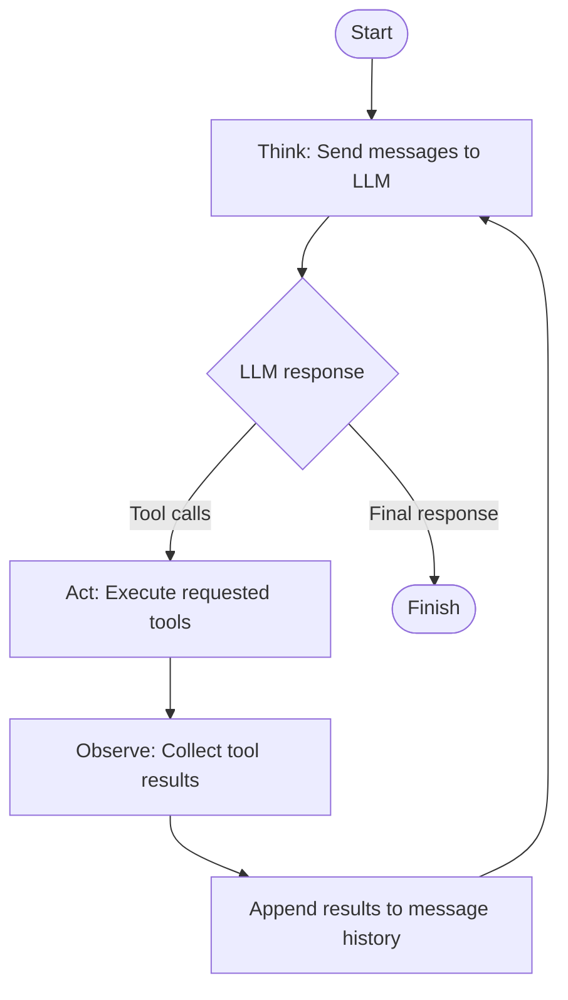

## Agent Execution Loop

The agent follows a **Think → Act → Observe → Iterate → Finish** cycle.

1. **Think:** Send the conversation history and available tools to the LLM.
2. **Act:** If the LLM requests tool calls, execute the requested tools.
3. **Observe:** Collect the results returned by the tools.
4. **Iterate:** Append the tool calls and their results to the conversation history, then send the updated messages back to the LLM.
5. **Finish:** When the LLM returns a final response without requesting additional tools, terminate the loop and return the response.

This loop allows the LLM to decide what actions are needed, observe their results, and continue reasoning until the task is complete.

